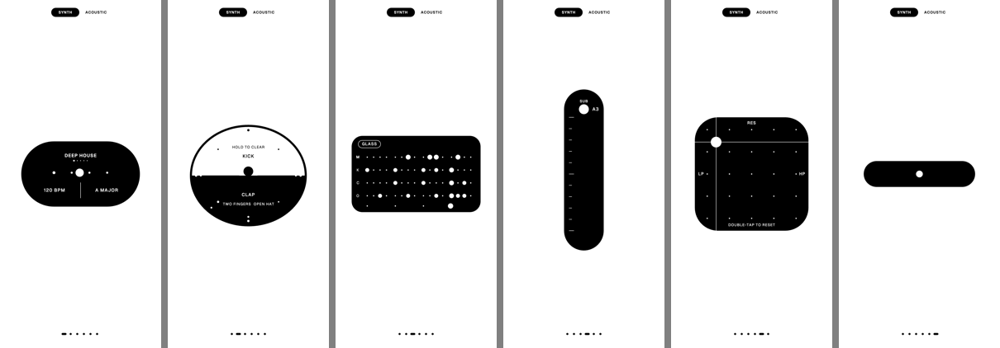

# One Shape

A musical instrument made of one shape. It morphs between six modes, and one knob travels with it.

**Play it: https://kurejas.github.io/one-shape/**



Works on iPhone Safari and Android Chrome first, and on desktop Safari and Chrome.

## What it does

| Mode | What you do |
|---|---|
| **Session** | Tap the style name to change style. Drag or tap the left half for tempo, the right half for key (tap toggles major / minor). |
| **Pad** | Top half kick, bottom half snare, two fingers hat. Hits are recorded into the loop. Hold to clear. |
| **Sequencer** | Tap steps on four lines: melody, kick, snare, hat. Tap a line's letter to mute it, the sound name to change the melody sound. |
| **Bass** | Drag to play a bass note. A second finger adds a second note. |
| **Filter** | Drag the puck: left and right sweep low-pass to high-pass, up adds resonance. Double-tap to reset. |
| **Tape stop** | Hold to wind the music down. It restarts on the next downbeat. |

- **Moving between modes:** tap outside the shape, swipe sideways, tap the dots, or use the arrow keys.
- **Styles:** Deep House, 2-Step, Lo-fi, Drum & Bass, Techno. Each keeps its own tempo, pattern and sounds.
- **SYNTH / ACOUSTIC:** the switch at the top swaps the synthesized kit for recordings of real instruments.
- **First visit:** a short walkthrough plays once through all six modes. Tap anywhere to stop it; the music keeps playing where it stopped. Add `?intro` to the address to see it again, or `?nointro` to skip it.
- **Keyboard:** arrows change mode, `1`–`6` jump to a mode, space plays, `J` `K` `L` play kick, snare and hat.

## Running it yourself

It is a static page: `index.html` plus the recordings in `samples/acoustic/`. Serve the folder with any web server, for example:

```bash
npx serve .
```

Opening `index.html` straight from disk also works, but browsers block the recordings there, so ACOUSTIC falls back to modelled sounds.

## How it is built

One HTML file, no dependencies. The picture is drawn on a canvas; every frame is a pure function of time and a log of what was played, and all motion uses closed-form springs. Sound comes from a synthesizer running in an AudioWorklet with a sample-accurate event queue, and the audio clock is the master clock. The recordings are fetched after the first frame, so the page opens at about 130 KB.

## Sound credits

- **Drums** (kick, snare, hi-hats, ride, cross-stick): *The Open Source Drumkit* by Real Music Media, public domain ([github.com/crabacus/the-open-source-drumkit](https://github.com/crabacus/the-open-source-drumkit)).
- **Upright piano, marimba, vibraphone, tambourine, claps, shaker, claves, woodblock:** *VCSL, the Versilian Community Sample Library* by Versilian Studios, CC0 ([github.com/sgossner/VCSL](https://github.com/sgossner/VCSL)).
- **Upright bass (pizzicato):** *Meatbass* by Karoryfer Lecolds, CC0 ([github.com/sfzinstruments/karoryfer.meatbass](https://github.com/sfzinstruments/karoryfer.meatbass)), a 1958 Otto Rubner double bass.
- **Classical guitar:** *University of Iowa Electronic Music Studios, Musical Instrument Samples* ([theremin.music.uiowa.edu/MIS.html](https://theremin.music.uiowa.edu/MIS.html)), free for any use without restriction.

All recordings are 44.1 kHz stereo, stored as 256 kbps MP3.
